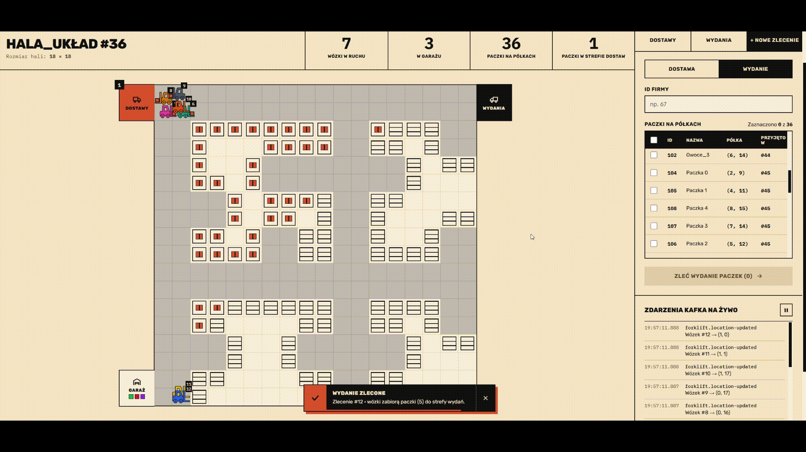
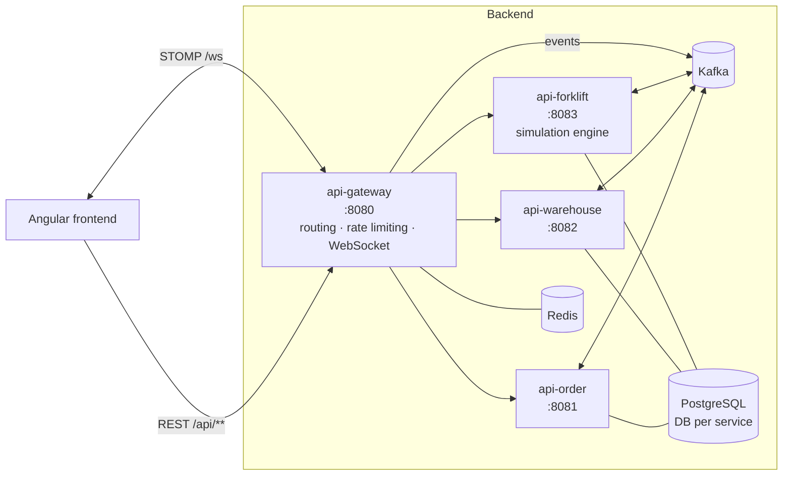
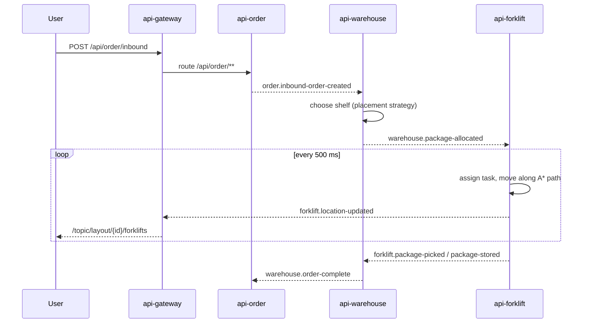

# YourAutoWarehouse

**Event-driven microservice backend for a simulated automated warehouse.** Draw a warehouse layout, submit inbound and outbound orders, and watch autonomous forklifts pick, store and ship packages in real time.

> 🖥️ Frontend (Angular): [front-YourAutoWarehouse](https://github.com/swiczka/front-YourAutoWarehouse)

<!-- TODO: add a 10–15 s GIF of the simulation here, e.g. docs/demo.gif -->



---

## What it does

- **Layout editor backend** – users design a grid warehouse (roads with allowed directions, shelves, garage, delivery and drop zones). Layouts are stored per user.
- **Orders** – inbound orders (packages arriving) and outbound orders (packages to ship) are accepted over REST.
- **Smart placement** – the warehouse service picks a free shelf for each incoming package using a pluggable placement strategy (currently: nearest shelf by Manhattan distance).
- **Forklift simulation** – a tick-based engine (every 500 ms) assigns tasks to free forklifts and moves them along paths computed with A\*, respecting two-lane, right-hand traffic.
- **Live updates** – forklift positions and package status changes are pushed to the browser over WebSocket (STOMP).

## Architecture



| Service | Port | Responsibility |
|---|---|---|
| `api-gateway` | 8080 | Single entry point (Spring Cloud Gateway MVC), Redis rate limiter, layout-ownership cache, STOMP broker pushing Kafka events to clients |
| `api-order` | 8081 | Inbound/outbound orders, order lifecycle |
| `api-warehouse` | 8082 | Layouts, packages, shelf allocation |
| `api-forklift` | 8083 | Forklift registry, task queue, A\* pathfinding, simulation ticks |
| `shared-common` | – | Shared event classes, DTOs, Kafka topic names, base exception handler |

### Example flow: an inbound order



Services communicate only via Kafka events for state changes. Synchronous REST between services is used only where a read is needed, e.g. the gateway checking layout ownership.

## Tech stack

- **Java 25**, **Spring Boot 4.1**, Spring Cloud Gateway (WebMVC), Spring Data JPA, Spring Kafka, Spring WebSocket/STOMP
- **Apache Kafka** (KRaft mode, no ZooKeeper)
- **PostgreSQL 17** with a separate database and user per service
- **Redis 7** for rate limiting and caching
- **JUnit 5 + Mockito**: about 130 unit tests across services
- **Docker / Docker Compose**, **GitHub Actions** (build and test → push images to GHCR → Trivy vulnerability scan)
- OpenAPI / Swagger UI for `api-order` and `api-forklift`

## Getting started

**Requirements:** Docker with Docker Compose. To run services from an IDE you also need JDK 25.

```bash
git clone https://github.com/swiczka/YourAutoWarehouse.git
cd YourAutoWarehouse
cp .env.example .env          # adjust credentials if you like
docker compose up --build
```

The API is then available at `http://localhost:8080`. To get the UI, run the [frontend](https://github.com/swiczka/front-YourAutoWarehouse) (`npm install && npm start`) and open `http://localhost:4200`.

Swagger UI:
- Orders: http://localhost:8081/swagger-ui.html
- Forklifts: http://localhost:8083/swagger-ui.html

**Running a single service from IntelliJ:** start the infrastructure with `docker compose up postgres kafka-1 redis`. Kafka exposes an external listener on `localhost:29092` for this purpose.

## API overview

All requests go through the gateway. Users are identified by an `X-Guest-Id` header (a UUID generated by the frontend).

| Method | Endpoint | Description |
|---|---|---|
| `POST` | `/api/warehouse/layout` | Save a new layout |
| `GET` | `/api/warehouse/layouts` | List the user's layouts |
| `GET` | `/api/warehouse/layout/{id}` | Get a layout |
| `POST` | `/api/order/inbound` | Create an inbound order |
| `POST` | `/api/order/outbound` | Create an outbound order |
| `GET` | `/api/order/layout/{layoutId}/inbound` | List inbound orders for a layout |
| `GET` | `/api/package/layout/{layoutId}` | List packages in a layout |
| `POST` | `/api/forklift/` | Add a forklift |

WebSocket: connect to `ws://localhost:8080/ws` and subscribe to `/topic/layout/{layoutId}/forklifts` and `/topic/layout/{layoutId}/packages`.

## Design decisions

- **Event-driven communication with Kafka.** Order intake, shelf allocation and forklift work happen at different speeds. Events decouple them, so a slow simulation never blocks taking new orders.
- **Database per service.** Each service owns its data, and the only way to influence another service is to publish an event.
- **Gateway on Tomcat instead of WebFlux.** The gateway started on WebFlux but was migrated to WebMVC/Tomcat to use Spring's STOMP-over-WebSocket support. Virtual threads keep it efficient.
- **In-memory simulation with eviction.** Active layouts are kept in a `LayoutCache` in the forklift service. A layout inactive for 20 minutes is removed to free memory.
- **Rate limiting in Redis.** Max 30 requests per 10 s per client, so the limit holds across gateway instances.
- **Strategy pattern for placement.** `PackagePlacementStrategy` allows swapping the shelf-selection algorithm without touching the order flow.

## Testing

```bash
./mvnw clean verify
```

Unit tests cover services, mappers, controllers, Kafka consumers, the A\* algorithm, the simulation engine and the gateway's cache and rate-limit configuration.

## Roadmap

- [ ] Integration tests with Testcontainers (Kafka and PostgreSQL)
- [ ] Authentication (Spring Security + JWT) replacing guest IDs
- [ ] Frontend included in `docker compose`
- [ ] Smarter task assignment (forklift load and schedule)

**Author:** Damian Świeca · [GitHub](https://github.com/swiczka) · <!-- TODO: LinkedIn link -->
